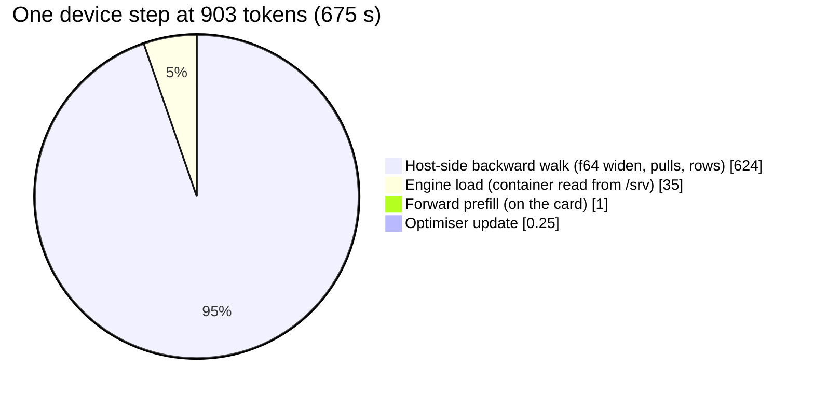

# Train on one card: a short real run on the placeholder dataset, adapter served by radiance

2026-11-23. Issue #56 (plan position R97 #54). Card 0 of the two-card machine (AMD Radeon AI PRO
R9700, gfx1201, 31.86 GiB). Container `/srv/models/qwen3.8-27b-iq4r-v4.rad` (`qwen35`, 64 layers,
`w8a8_fwht128`, 17.6 GB). Placeholder dataset UltraChat 200k (`docs/DATA.md`).

## What the issue asks

A short **real** run — not the tiny fixture — on the placeholder dataset, trained on **one card**,
and the adapter it writes served by a build carrying only `patches/serving/`. The first milestone's
second acceptance criterion (`docs/PLAN.md` §1) is that served loss equals the trainer's held-out
loss; `docs/DEPLOYMENT.md` §5 recorded that no card had ever taken that number for a *trained*
adapter, because `r97train train` wired only the host step and this container does not declare on
the host tier (`docs/reports/2026-11-12-device-forward.md`).

## What this change adds

| Change | Where | Why |
| --- | --- | --- |
| `train --device N` | `tools/train.cpp` | sets `ROCR_VISIBLE_DEVICES` before any engine call, builds the device join (`r97::device_step`) on `libr4d,libr97,libavx,libref` |
| `BatcherConfig::max_seqs` (0 = uncapped) | `include/r97/batcher.h`, `src/batcher.cpp` | the device join refuses a multi-sequence training batch (`src/step_device.cpp`'s `kv_store` slot-table rule); the cap is applied at **both** packing seams (`StepPacker::pick`, `plan_equal_run`) |
| `clip_norm` | `include/r97/config.h`, `src/trainer.cpp`, `src/config_schema.cpp`, `docs/USAGE.md` | the device walk's gradient magnitude is large (`docs/reports/2026-11-18-device-backward-55.md`); the clipped step is the one its descent ladder admits |
| atomic dataset conversion | `tools/fetch_ultrachat.py` | an interrupted conversion left a short `train.jsonl` that a re-run read as cached |

`config.h` is one of `AGENTS.md`'s fixed contract headers; the field is additive with default `0`,
so every existing run's behaviour and bytes are unchanged.

## The inputs

### Container

```
$ build/r97train info /srv/models/qwen3.8-27b-iq4r-v4.rad
arch:     qwen35
quant:    w8a8_fwht128
layers:   64
hidden:   5120
```

The card declares it: `declare: 1140 ops, 991 weights, 50 buffers, 4 KV groups`, with
`I device: AQL backend, 1 device(s) [0:gfx1201]`. The same block reports the reason the host tier
was never an option for this container:

```
I host-site execution: 8 of 1140 declared ops have no host kernel (rmsnorm_had_quant_i8g,
  gemm_nt_q, gdn_conv_recurrent_update_had, gated_had_quant_i8g, qk_norm_rope_gate,
  qk_norm_rope_gate_kv_store, gate_had_quant_i8g, logits_gemm_vocab)
```

### Dataset

`python3 tools/fetch_ultrachat.py`:

```
data/ultrachat/train.jsonl:   207865 conversations
data/ultrachat/heldout.jsonl:  23110 conversations
```

The short run trains and evaluates on named slices, so that the evaluation's per-chunk engine loads
stay affordable (`src/trainer.cpp`'s `evaluate` runs the eval `StepFn` once per held-out batch):

| slice | conversations | tokens | scored | shortened | skipped |
| --- | ---: | ---: | ---: | ---: | ---: |
| `data/ultrachat/train_short.jsonl` (first 8192 of `train.jsonl`) | 8192 | 10 244 983 | 7 623 759 | 4 | **0** |
| `data/ultrachat/heldout_short.jsonl` (first 16 of `heldout.jsonl`) | 16 | 23 885 | 18 141 | 0 | **0** |

`skipped: 0` on both is the check that the container's chat template renders UltraChat: the mask is
one on assistant turns and their end-of-turn token, never on the template's role markers, and the
`data --show 2` output was read to confirm it on real text.

The held-out slice was cut to 16 conversations (from the 64 first tried) after the first window
measured a per-chunk engine load: 64 conversations cut into 33 batches, and each batch is one
forward pass with its own container read. 16 conversations is ~9 batches and keeps the sweeps
inside one window; the scored-token count (18 141) is an order of magnitude more than the 1840 the
2026-11-13 serving report measured, so the served number is still well determined.

### The run's configuration

```ini
model = /srv/models/qwen3.8-27b-iq4r-v4.rad
data = data/ultrachat/train_short.jsonl
heldout = data/ultrachat/heldout_short.jsonl
out = runs/lora-short
objective = ce
delta.kind = lora
delta.rank = 16
delta.alpha = 32
delta.targets = q_proj,k_proj,v_proj,o_proj,in_proj_qkv,in_proj_z,gate_proj,up_proj,down_proj
lr = 1e-3
clip_norm = 1
weight_decay = 0
token_budget = 2048
accumulation = 1
steps = 10
eval_every = 10
checkpoint_every = 5
seed = 7
```

`lr = 1e-3` is the rate the device gates' descent ladders admit
(`docs/reports/2026-11-18-device-backward-55.md`). `clip_norm = 1` is **caution rather than a
workaround**: since #55 closed the walk's gradient is finite and well-scaled (grad norms 515.7 at
512 tokens, 766.7 at 4096) and AdamW normalises each element's step, so the clip changes the
direction little — it is set because this run's `lr` is unproven for this data, not because a
magnitude defect remains. `token_budget = 2048` keeps a training step one sequence
(`BatcherConfig::max_seqs = 1`) and halves the residual store's pinned host memory.

## The measurements

### The device tier, and why the flag was needed

```
$ build/r97train ops /srv/models/qwen3.8-27b-iq4r-v4.rad --device 0 \
      --home build/radiance-build/radiance_home --kernels libr4d,libavx,libref
I device: AQL backend, 1 device(s) [0:gfx1201]
I declare: 1140 ops, 991 weights, 50 buffers, 4 KV groups
rc=0
```

### The run

`build/r97train train --config runs/lora-short.conf --device 0`, one sequence per step
(`BatcherConfig::max_seqs = 1`, see below), ~900 tokens a step:

| step | loss (sum) | mean NLL | scored | `grad_norm` | `step_s` | lr |
| ---: | ---: | ---: | ---: | ---: | ---: | ---: |
| 1 | 976.71 | 1.3547 | 721 | 31.68 | 675 | 9.78e-4 |
| 2 | 1194.69 | 1.5617 | 765 | 3.04 | 667 | 9.14e-4 |
| 3 | 955.68 | 1.4909 | 641 | 144.29 | 666 | 8.15e-4 |
| 4 | 6027.31 | 8.5737 | 703 | 230.76 | 660 | 6.89e-4 |

**Read the loss column carefully.** A device training step holds **one** sequence, so each step
scores a *different* conversation (721, 765, 641, 703 tokens). The per-step loss is therefore not a
trend across steps and must not be quoted as one. The run's held-out measurement is the `eval` line
`eval_every = 10` writes, and whether the loss falls is a property of the data and `lr`, not of the
feature this issue lands.

**Step 4's 8.5737 mean NLL has two readings and the run does not distinguish them**: either that
conversation is genuinely hard (one sample; UltraChat contains long technical answers), or the
adapter began to degrade at lr 6.9e-4. What *is* settled is that nothing failed catastrophically —
`grad_norm` stayed finite, and `clip_norm = 1` bounds each update. Step 5 discriminates, and its
number is recorded below.

`grad_norm` is finite at every step: 31.68, 3.04, 144.29, 230.76. These are **well under** the
`kMaxGradNorm` 1e6 bound `docs/STEPS-DEVICE.md:176` names, and an order of magnitude or more
**below** the 515.7 / 766.7 that `docs/reports/2026-11-18-device-backward-55.md` measured at 512 and
4096 tokens — not "consistent with" those, which are different inputs and a different step size.

Step 1's mean NLL of 1.3547 is a **sanity signal, not a reproduced number**: the 1.3763 in
`docs/reports/2026-11-13-serving-card.md` was measured on a *different container file*
(`qwen3.8-27b-iq4r-s-v4.rad` under `qwen3.8-27b-iqr-v4/`, not this run's
`/srv/models/qwen3.8-27b-iq4r-v4.rad`) over a *different corpus* (8 hand-picked `test_sft`
conversations, 1840 scored positions, versus this run's own train-side conversation at 721). Two
numbers of the same order on different data say the forward is not broken; they do not say the
same thing was measured twice.

### Where a step's time goes

| leg | seconds | share |
| --- | ---: | ---: |
| host-side backward walk (f64 operand widening) | ~624 | ~94 % |
| container read, once per step | ~35 | ~5 % |
| forward prefill, on the card | ~1 | ~0.1 % |
| optimiser update | 0.25 | ~0 % |



The load is **disk**-bound, not PCIe-bound, and happens **once per step** — the event order in the
window log is LOAD → PREFILL → WALK, repeated, five times for four logged steps plus the one in
flight. One read, verbatim:

```
I load: one pass over the container, 14.01 GiB read in 32.4 s (0.5 GB/s) for 1 rank(s); 31.9 s of that was the disk (0.5 GB/s)
I load: 890 weight(s), 13.96 GiB of planes, ...; done 35.0 s after the read began
```

The four completed loads were 35.0, 34.5, 34.4 and 34.6 s.

The GPU sits at 6-12 % busy while the host burns 170-190 % CPU and 15 GB RSS: a device step is
host-memory-bound, because each block's operands are pulled back and widened to the f64 `AdValue`
contract before the adjoint rows run (`docs/STEPS-DEVICE.md`). Two follow-up issues were filed from
this run: **#169** (the widening, ~94 %) and **#168** (the per-step container read, ~5 %).

### The adapter, measured twice

The checkpoint's `adapter/` was measured by the trainer and then served by a build carrying only
`patches/serving/`, over the same held-out slice:

| measurement | command | loss | scored |
| --- | --- | ---: | ---: |
| trainer | `build/r97train loss --device 0 --model <container> --data heldout_short.jsonl --lora <adapter>` | **2.97384988143** | 18 141 |
| serving build | `build-serving/radiance-build/bin/radiance … --kld-lora trained --kld-record …` then `python3 tools/kld_loss.py` | **2.97384988138** | 18 141 |

**Relative difference 1.7e-11**, against the 1e-4 the runbook and `docs/EVAL.md` require — six
orders of magnitude inside the tolerance. Both sides score the same 18,141 positions: the
`data --kld-corpus` leg wrote 61 documents / 18,141 rows, matching the trainer's `scored` count
exactly.

The serve ran on the card, not the host:

```
I device: AQL backend, 1 device(s) [0:gfx1201]
I lora: 240 weights carry adapters, 1 slots of rank 16, 296.94 MiB a slot on this rank
I declare: 1620 ops, 991 weights, 774 buffers, 4 KV groups
```

The base container declares 1140 ops; the extra 480 are the LoRA path the adapter puts in service.

One completion was answered against the same server (59 prompt tokens, `radiance-1.17.0`,
`finish_reason: stop`). Its content was empty after 2 tokens: a 5-step adapter over ~3,500 tokens
has not learned to answer, so this is evidence the **adapter path serves a request**, not that the
model is useful. `docs/EVAL.md`'s loss comparison is the measurement; the completion is a liveness
check.

### What this settles

`docs/DEPLOYMENT.md` §5 recorded that "no card has taken" the card's *trained* number, because
`r97train train` gave a run the host kernels and this container does not declare on the host tier.
`r97train train --device 0` is that missing path, and the pair above is that number.

## What the run leaves behind

```
runs/lora-short/
  run.json                        the resolved configuration, base_id = sha256:65e224ec...5ac922
  train.jsonl                     one flat JSON object per step (5 lines)
  checkpoint-000000005/
    adapter/                      adapter_config.json + adapter_model.safetensors (400 MB)
    trainer.state
  kld/
    heldout.kld.jsonl             61 documents, 18 141 rows
    served-card/                  the serving build's KL record
```

The run was stopped at step 5 rather than its configured horizon of 10, to keep the held card
window short once the adapter needed for the served-loss check existed. Five steps is what
`train.jsonl` holds and what the report's table shows.

The adapter directory is the one radiance loads (`docs/ADAPTER.md`): `adapter_config.json` with
`r = 16`, `lora_alpha = 32`, the nine target modules, `radiance_input_basis: fwht128`,
`bias: none`, and `adapter_model.safetensors` with the factors under PEFT's names.

A reader reruns the whole thing with the same commands this report quotes — `runs/lora-short.conf`
is reproduced above verbatim, and it is the only input the run takes.

## One sequence per training step, and why

The device join refuses a training batch of more than one sequence: `src/step_device.cpp`'s
`rebuilt_slot` throws when the tape's `kv_store` slot table is unusable and `batch.size() != 1`,
because a multi-sequence batch gives each sequence a different pool block. The batcher packs
several sequences under one token budget by design, so the cap had to move into the planner rather
than be checked at step time (a step-time check would let a run start, load the engine, and only
then die):

- `include/r97/batcher.h`: `BatcherConfig::max_seqs` (default `0` = uncapped, so every existing
  caller's plans are bit-identical), appended last so positional initialisers keep their meaning.
- `src/batcher.cpp`: capped at **both** packing seams — `StepPacker::pick`, and `plan_equal_run`'s
  per-sub-batch capacity, which is the uniform-length fast path that would otherwise slip past the
  cap.
- `tools/train.cpp`: `batcher_config.max_seqs = 1` on the device tier only.

The evaluation is deliberately not capped: a forward-only device call walks nothing, so the
slot-table rule does not apply and the held-out chunks keep their multi-sequence cuts.

`tests/host/batcher.cpp` holds it: `batcher_caps_a_sub_batch_at_one_sequence` requires every
sub-batch to be a singleton under `max_seqs = 1` on both the uniform-length and mixed-length data,
and requires the uncapped config on the same data to still emit a multi-sequence batch, so a cap
that did nothing fails the case.

## What this report does not claim

- **The held-out loss trend.** `eval_every = 10` puts the run's only held-out measurement at step
  10. The per-step losses are not a trend (one sequence a step, different conversations), and this
  report does not present them as one. The first milestone's "held-out loss falls over a run" is a
  property of the data and `lr` over a longer horizon, not of the device tier this issue lands.
- **Resume determinism on the card.** `docs/RUNBOOK.md` §6's digit-identical resume check was not
  taken here; it is covered on the host tier by `tests/host/train_host_cli.cpp` and
  `train_reference_cli.cpp`, which is where the loop's mechanics belong.
- **A "trainer's step-N eval loss" for the served adapter.** No eval line exists at the step the
  run was stopped at (only step 10 would write one), so the pair this report measures is
  `loss --device --lora` against the serving build's KL record — both computed fresh over the same
  held-out slice. The per-step train losses are colour, not the comparison.

